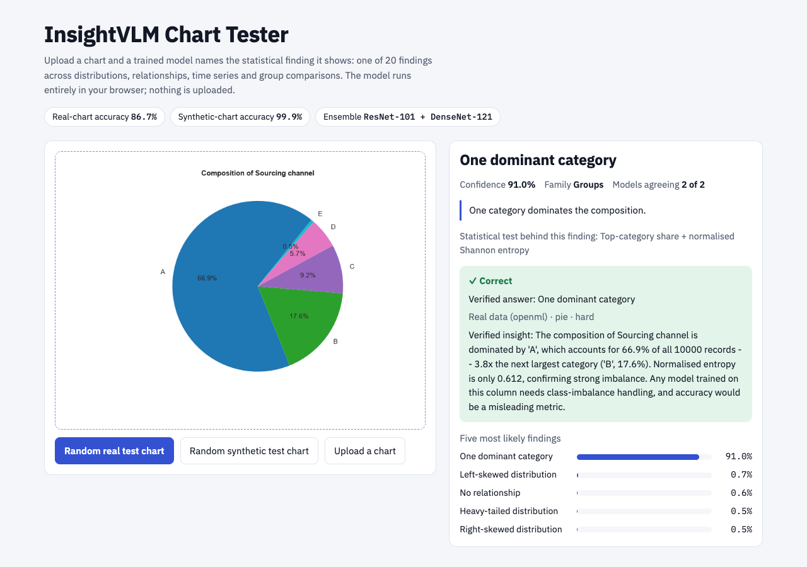
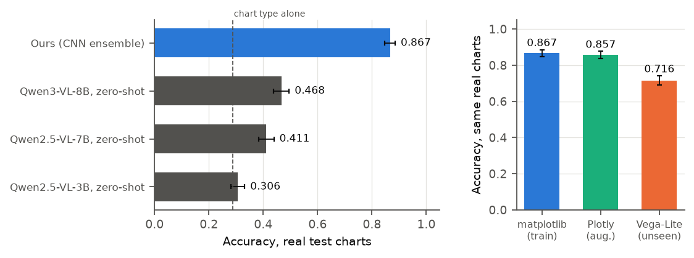

# InsightVLM

**Automated statistical reasoning from chart images.** Given a chart, name the statistical
finding it shows — bimodality, heteroscedasticity, a level shift, a non-significant group
difference, and 16 more — with labels that a named statistical test has confirmed on the
exact data plotted.

**[▶ Try the live demo](https://huggingface.co/spaces/AsifZaman1912/InsightVLM)** ·
[Thesis (PDF)](thesis/main.pdf) ·
[Paper draft (PDF)](paper/scidata/insightvlm_scidata.pdf) ·
[Documentation](docs/)



---

## Overview

Chart datasets train models to answer a question, describe a figure or rebuild the code
that drew it. None of them asks a model to state **what the data shows** and checks the
answer against the data. InsightVLM does:

- **InsightVLM-20K** — 20,000 charts in 26 chart types, labelled with one of 20 statistical
  findings. A label is issued only when a named test (Shapiro–Wilk, Hartigan's dip,
  Mann–Kendall, Breusch–Pagan, Kruskal–Wallis, …) confirms it on exactly the plotted array
  and no other class matches. Re-running the tests reproduces 99.95% of labels.
- **6,083 charts from 654 real public tables** (OpenML, World Bank, Our World in Data, UCI,
  vega-datasets, seaborn-data) in source-disjoint splits, so real-data generalisation is
  measured directly. Every sample also carries its data table, statistics, a reasoning
  chain, an evidence-grounded insight and pixel-level evidence boxes.
- **Models and an evaluation protocol**: a CNN ensemble, zero-shot vision–language
  baselines, tests on charts re-drawn by two other plotting libraries, confidence
  intervals, paired significance tests and a Grad-CAM grounding analysis.

## Results

Held-out test split, scored once; every selection was made on the validation split.

| System | Real charts (n = 1,192) | Real charts, unseen plotting library | Synthetic charts (n = 2,808) |
|---|---|---|---|
| **InsightVLM ensemble** (ResNet-101 + DenseNet-121) | **86.7%** [84.6, 88.6] | **71.6%** [69.0, 74.1] | **99.9%** |
| Qwen3-VL-8B, zero-shot | 46.8% [43.9, 49.6] | – | 64.8%¹ |
| Qwen2.5-VL-7B, zero-shot | 41.1% [38.3, 44.0] | – | 49.8%¹ |
| Qwen2.5-VL-3B, zero-shot | 30.6% [28.1, 33.2] | – | 30.3%¹ |
| Chart type alone (no pixels) | 28.8% | – | – |
| Statistical oracle on the data table | 99.95% | – | 99.95% |

Brackets: 95% bootstrap confidence intervals. ¹ On a fixed 400-chart synthetic sample.
The ensemble beats every zero-shot model on the same charts (exact McNemar *p* < 10⁻¹⁰⁰).
Removing the 85 real test charts whose data also appears in training data under another source
table (near-duplicates, `build/14_near_duplicates.py`) gives 86.3% [84.3, 88.3].
Across three training seeds the recipe scores 86.3% ± 0.4 on real charts (`train/seed_variance.py`).



What the numbers say:

- **Current vision–language models cannot do this out of the box.** The best reaches
  46.8%; the smallest is barely above a rule that only looks at the chart type.
- **Rendering matters as much as data.** Trained on one plotting library, models lose
  about 10 points on Plotly re-renders and 22–25 points on Vega-Lite. Training on charts
  drawn three ways (matplotlib, Plotly and randomised styles) recovers most of it.
- **Errors are judgements of degree.** Most remaining errors confuse neighbouring shapes
  (bimodal ↔ right-skewed, heavy-tailed ↔ right-skewed, small ↔ no group difference).

See [docs/RESULTS.md](docs/RESULTS.md) for ablations, per-class accuracy, the grounding
analysis and the rendering-leak study.

## Repository structure

```
InsightVLM/
├── build/          dataset pipeline: harvest → mine → synthesise → verify → render → audit
├── train/          training-notebook generator, ensemble, evaluation, statistics, grounding
├── notebooks/      Kaggle training notebooks (generated by train/make_split_notebooks.py)
├── deploy/         ONNX export and the in-browser demo (deploy/web)
├── results/        final metrics, per-model probabilities, statistics (small files only)
├── dataset/        class index, datasheet and bias-audit report (the images are released separately)
├── paper/          manuscript draft and figure scripts
├── thesis/         thesis source (LaTeX) and PDF
├── docs/           documentation
├── app.py          local Gradio tester
└── run_all.py      end-to-end dataset build
```

## Quick start

**Use the demo** — no installation: <https://huggingface.co/spaces/AsifZaman1912/InsightVLM>.
The model runs in the browser; uploaded charts never leave the computer.

**Run the demo locally** (the Space holds the page, the ONNX model and sample charts; needs `git-lfs`)

```bash
git clone https://huggingface.co/spaces/AsifZaman1912/InsightVLM insightvlm-demo
cd insightvlm-demo && python -m http.server 8000      # then open http://localhost:8000
```

**Rebuild the dataset and reproduce the results**

```bash
pip install -r requirements.txt
python run_all.py                     # build InsightVLM-20K into dataset/
python train/final_ensemble.py        # deployed ensemble from the cached probabilities in results/probs
python train/stats_report.py          # results table, confidence intervals, McNemar tests
```

Training ran on Kaggle (2× T4) from the notebooks in `notebooks/`. The full sequence is in
[docs/REPRODUCE.md](docs/REPRODUCE.md).

## Documentation

| Document | Contents |
|---|---|
| [DATASET.md](docs/DATASET.md) | Finding taxonomy, verification gate, sources and licences, splits, files and fields |
| [METHODS.md](docs/METHODS.md) | Rendering, models, training recipe, ensemble, evaluation protocol |
| [RESULTS.md](docs/RESULTS.md) | All results, ablations, error analysis, grounding, rendering-leak study |
| [REPRODUCE.md](docs/REPRODUCE.md) | Every command, in order, and which file each number comes from |
| [DEMO.md](docs/DEMO.md) | How the demo works and how to run it |

## Data availability

The dataset (v2) is archived on Zenodo, [doi:10.5281/zenodo.23968282](https://doi.org/10.5281/zenodo.23968282)
(CC BY 4.0), and mirrored on [Kaggle](https://www.kaggle.com/datasets/asifxzaman/insightvlm-20k-v2).
The class index, datasheet and bias-audit report are also in [`dataset/`](dataset/).

## Team

**Team Hocrux** — A K M Asifuzzman, Robiul, Fahim Ali, Iftehad, Md Arfat Yunus.
Phitron AI/ML Thesis Track.

## Citation

```bibtex
@misc{insightvlm2026,
  title  = {InsightVLM-20K: Chart Images Paired with Statistically Verified Findings},
  author = {Asifuzzman, A K M and Robiul and Ali, Fahim and Iftehad and Yunus, Md Arfat},
  year   = {2026},
  url    = {https://github.com/A-K-M-Asifuzzaman/InsightVLM}
}
```

## License

Code: [MIT](LICENSE). Dataset: CC BY 4.0 for the corpus; real-source charts keep the
licence of their source table (recorded per sample), synthetic charts are CC0.
