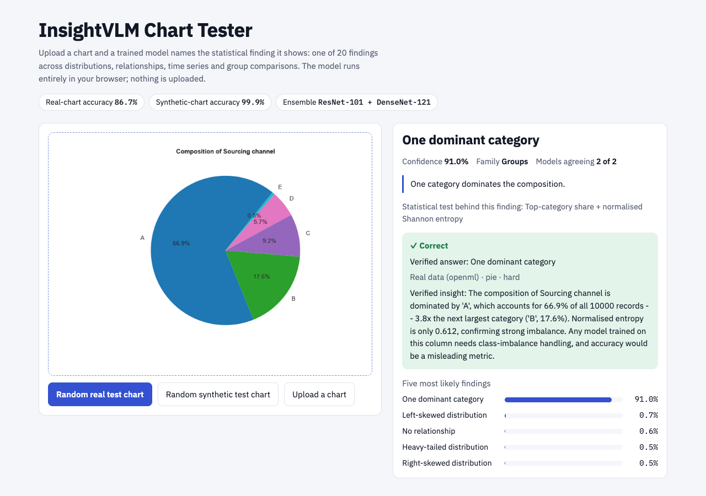
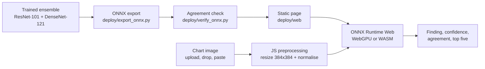

# InsightVLM Chart Tester: An In-Browser Demonstration

**A. K. M. Asifuzzaman, Robiul Hasan Jisan, Fahim Khan Alif, Iftehad Kamal Iftee, and Mohammad Arfat**

Team Hocrux, Phitron AI/ML Thesis Track

[Live Demo](https://huggingface.co/spaces/AsifZaman1912/InsightVLM) · [Dataset (Zenodo)](https://doi.org/10.5281/zenodo.23968282) · [Back to README](../README.md)

[](assets/demo.png)

*Fig. 1. The InsightVLM chart tester. The ensemble runs entirely in the browser and reports the predicted finding, its confidence, member agreement and the defining statistical test.*

* * *

***Abstract*—This document describes the InsightVLM chart tester, a web demonstration of the deployed CNN ensemble (ResNet-101 + DenseNet-121) from InsightVLM-20K. A user supplies a chart image and the page names the statistical finding the plotted data supports, out of 20 classes. The ensemble is exported to a single ONNX graph and executed client-side by ONNX Runtime Web, using WebGPU when available and WebAssembly otherwise, so no image is uploaded. The page reimplements the evaluation preprocessing (antialiased bilinear resize to 384 × 384 followed by ImageNet normalisation) in JavaScript, and the exported model agrees with the evaluated ensemble on all 4,000 test charts. We describe usage, architecture, local deployment and known limits, including reduced reliability on charts from plotting libraries unlike the training renderers (71.6% on an unseen library).**

***Index Terms*—Chart understanding, in-browser inference, ONNX Runtime Web, WebGPU, model deployment, statistical reasoning, explainability.**

* * *

## I. Overview

The tester lets anyone try the InsightVLM ensemble without installing software. It is hosted as a static page on Hugging Face Spaces: <https://huggingface.co/spaces/AsifZaman1912/InsightVLM>. The model (198 MB) downloads once and is then cached by the browser. Inference runs on the user's device, and uploaded charts never leave the computer.

## II. Using the Tester

### A. Input Modes

The page accepts a chart in three ways, and offers two ways of drawing a test chart:

1. **Upload a chart.** Click the panel, drag an image onto it, or paste from the clipboard.
2. **Random real test chart.** Draws one of 400 held-out test charts and shows the prediction next to the verified answer.
3. **Random synthetic test chart.** Same as above, drawn from the synthetic test charts.

For a random test chart the page also shows the chart's source, chart type and verified insight, so the prediction can be checked against ground truth.

### B. Output

For every chart the page reports the items in Table I.

**TABLE I**  
*OUTPUT SHOWN FOR EACH CHART*

| Item                  | Description                                                                 |
|-----------------------|-----------------------------------------------------------------------------|
| Finding               | The predicted statistical finding (one of 20 classes)                       |
| Confidence            | Ensemble probability of the predicted finding                               |
| Member agreement      | How many ensemble members agree on the finding                              |
| Definition and test   | The definition of the finding and the statistical test behind it            |
| Top five              | The five most likely findings                                               |
| Low-confidence notice | Shown below 50% confidence: the chart may show mixed patterns or one outside the 20 classes |

## III. System Architecture

### A. Export and Runtime

The deployed ensemble (ResNet-101 + DenseNet-121) is exported to a single ONNX graph with `deploy/export_onnx.py` and executed in the browser by ONNX Runtime Web (WebGPU when available, otherwise WebAssembly). The pipeline from checkpoint to page is shown in Fig. 2.



*Fig. 2. Deployment path of the InsightVLM chart tester.*

### B. Preprocessing Fidelity

Preprocessing reproduces evaluation exactly. The page implements PIL's antialiased bilinear resize to 384 × 384 in JavaScript, followed by ImageNet normalisation, so the browser sees the same input tensor as the evaluation code.

### C. Verification

`deploy/verify_onnx.py` confirms that the ONNX model agrees with the evaluated ensemble on all 4,000 test charts. The page itself agreed with the ONNX model on every chart we tested in a headless browser.

**TABLE II**  
*DEPLOYMENT PROPERTIES*

| Property            | Value                                                   |
|---------------------|---------------------------------------------------------|
| Models              | ResNet-101 + DenseNet-121 (equal-weight ensemble)       |
| Format              | Single ONNX graph                                       |
| Runtime             | ONNX Runtime Web (WebGPU, otherwise WebAssembly)        |
| Model size          | 198 MB, downloaded once and cached by the browser       |
| Input               | 384 × 384, ImageNet normalisation                       |
| Classes             | 20 findings                                             |
| Random test charts  | 400 held-out charts                                     |
| Agreement check     | ONNX vs. evaluated ensemble, all 4,000 test charts      |
| Data privacy        | Inference on-device, nothing uploaded                   |

## IV. Running Locally

**Static demo** (needs `git-lfs`):

```bash
git clone https://huggingface.co/spaces/AsifZaman1912/InsightVLM insightvlm-demo
cd insightvlm-demo && python -m http.server 8000      # then open http://localhost:8000
```

**Gradio version** (needs the trained checkpoints and `dataset/`):

```bash
pip install -r requirements-app.txt
python app.py
```

## V. Limitations

- **Closed label set.** The tester knows only the 20 findings and reports one per chart. Below 50% confidence the page warns that the chart may show mixed patterns or one outside the 20 classes.
- **Renderer shift.** Charts drawn by tools unlike the training renderers are less reliable: accuracy is 71.6% on an unseen plotting library (Vega-Lite), against 86.7% on matplotlib renders of real charts.
- **Weakest classes.** Heavy tails, left skew and seasonality are the hardest findings; their real test counts are small (n = 26, 19 and 13), so per-class accuracies are indicative only.

## VI. Related Documents

**TABLE III**  
*SUPPLEMENTARY DOCUMENTS*

| Document                      | Contents                                                                    |
|-------------------------------|-----------------------------------------------------------------------------|
| [DATASET.md](DATASET.md)      | Taxonomy, verification gate, sources and licences, splits, files and fields |
| [METHODS.md](METHODS.md)      | Rendering, models, training recipe, ensemble, evaluation protocol           |
| [RESULTS.md](RESULTS.md)      | All results, ablations, error analysis, grounding, rendering-leak study     |
| [REPRODUCE.md](REPRODUCE.md)  | Every command in order and the file behind each number                      |

**License.** Code: [MIT](../LICENSE). Dataset: CC BY 4.0 for the corpus; real-source charts keep the licence of their source table; synthetic charts are CC0.

## Acknowledgment

This work was carried out by Team Hocrux in the Phitron AI/ML Thesis Track.

## References

[1] K. He, X. Zhang, S. Ren, and J. Sun, "Deep residual learning for image recognition," in *Proc. IEEE Conf. Comput. Vis. Pattern Recognit. (CVPR)*, 2016, pp. 770–778.

[2] G. Huang, Z. Liu, L. van der Maaten, and K. Q. Weinberger, "Densely connected convolutional networks," in *Proc. IEEE Conf. Comput. Vis. Pattern Recognit. (CVPR)*, 2017, pp. 4700–4708.

The full reference list is in the [README](../README.md#references).