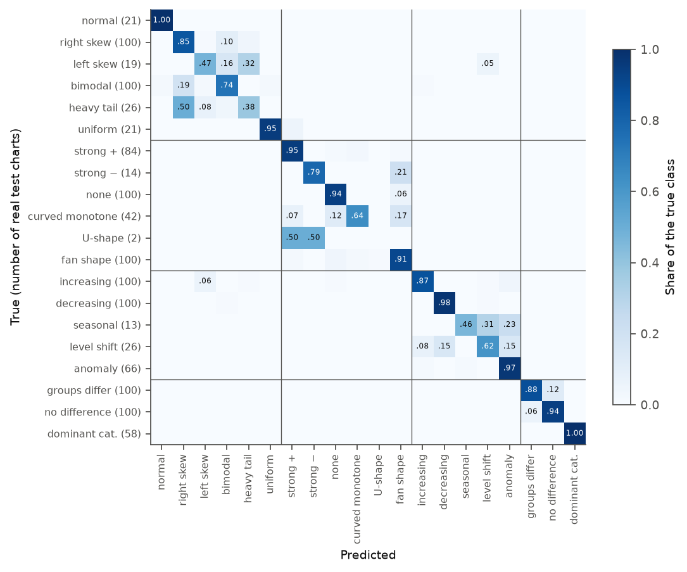
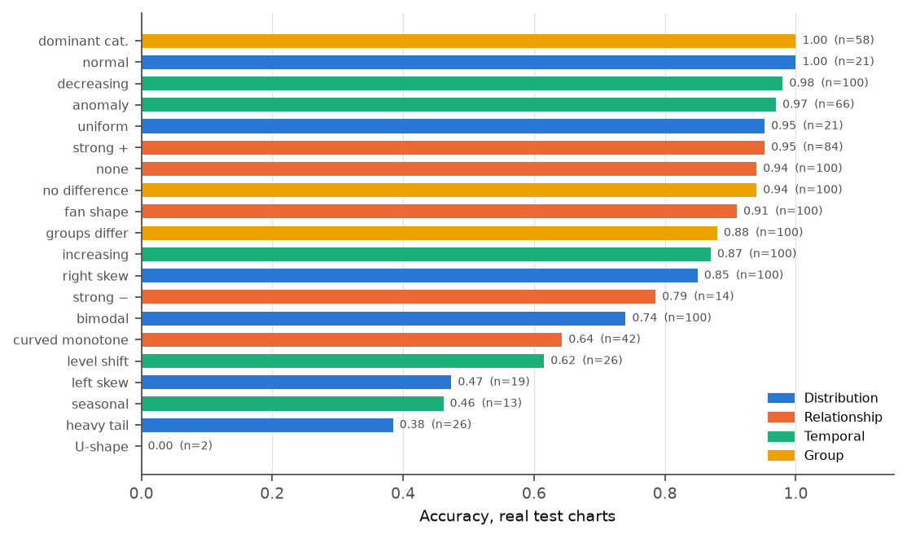
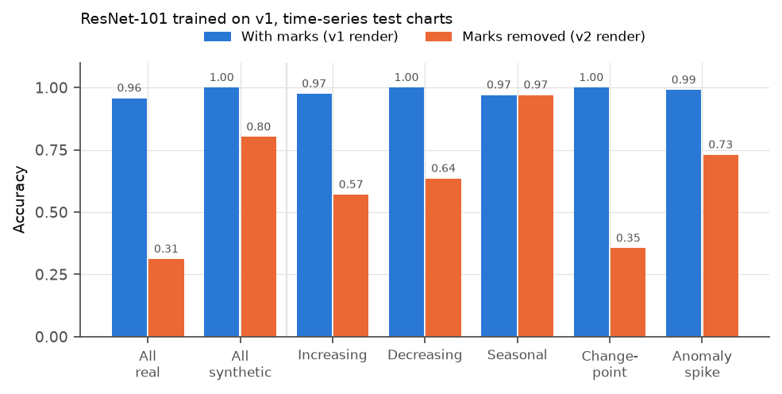

# InsightVLM-20K: Results

**A. K. M. Asifuzzaman, Robiul Hasan Jisan, Fahim Khan Alif, Iftehad Kamal Iftee, and Mohammad Arfat**

Team Hocrux, Phitron AI/ML Thesis Track

[Live Demo](https://huggingface.co/spaces/AsifZaman1912/InsightVLM) · [Dataset (Zenodo)](https://doi.org/10.5281/zenodo.23968282) · [Back to README](../README.md)

* * *

***Abstract*—This document reports every result for InsightVLM-20K on the held-out test split, scored once. The deployed ensemble (ResNet-101 + DenseNet-121) reaches 0.867 accuracy on real matplotlib charts (95% CI 0.846–0.886), 0.857 on Plotly renders, 0.716 on Vega-Lite renders never seen in training, and 0.999 on synthetic charts, against 0.468 for the best zero-shot vision–language model. Three-seed retraining gives 0.863 ± 0.004 on real charts. We analyse where the model fails (distribution shape, and classes with few real examples), measure the effect of 85 near-duplicate test charts (0.863 without them), report a two-annotator human label check (73.7% of labels confirmed), a Grad-CAM pointing-game grounding analysis (+0.085 over a random control), a generative QLoRA baseline, and a controlled ablation showing that version 1 of the dataset leaked the label through drawn marks.**

***Index Terms*—Chart understanding, benchmark results, bootstrap confidence intervals, McNemar test, human evaluation, Grad-CAM, shortcut learning.**

* * *

All numbers are on the held-out test split, scored once. Source files: `results/stats_report.json`, `results/final_ensemble.json`, `results/grounding.json` and `results/ablate_marks.csv`. The mapping from every number to its file is in [REPRODUCE.md](REPRODUCE.md).

## I. Main Results

**TABLE I**  
*TEST ACCURACY ON THE HELD-OUT SPLIT. BRACKETS: 95% BOOTSTRAP CI.*

| System                                         | Real · matplotlib        | Real · Plotly            | Real · Vega-Lite         | Synthetic |
|------------------------------------------------|--------------------------|--------------------------|--------------------------|-----------|
| Chart type alone (no pixels)                   | 0.288                    | –                        | –                        | –         |
| Qwen2.5-VL-3B, zero-shot                       | 0.306                    | –                        | –                        | 0.303ᵃ    |
| Qwen2.5-VL-7B, zero-shot                       | 0.411                    | –                        | –                        | 0.498ᵃ    |
| Qwen3-VL-8B, zero-shot                         | 0.468                    | –                        | –                        | 0.648ᵃ    |
| ResNet-101, balanced split                     | 0.841                    | 0.747                    | 0.607                    | 0.997     |
| ResNet-50, balanced split                      | 0.828                    | 0.722                    | 0.608                    | 0.998     |
| ResNet-101, + supplementary pool               | 0.840                    | 0.735                    | 0.602                    | 0.999     |
| ResNet-50, + supplementary pool                | 0.845                    | 0.760                    | 0.599                    | 0.998     |
| DenseNet-121, + supplementary pool             | 0.861                    | 0.771                    | 0.638                    | 0.997     |
| ResNet-101, + pool + renderer augmentation     | 0.859                    | 0.854                    | 0.650                    | 0.998     |
| DenseNet-121, + pool + renderer augmentation   | 0.855                    | 0.852                    | 0.712                    | 0.998     |
| **Ensemble (deployed)**                        | **0.867** [0.846, 0.886] | **0.857** [0.836, 0.877] | **0.716** [0.690, 0.741] | **0.999** |
| Statistical oracle on the data table           | 0.9995                   | –                        | –                        | 0.9995    |

ᵃ Fixed 400-chart synthetic sample.

Over all 4,000 test charts the ensemble scores 0.959; macro-F1 on real charts is 0.776. Against Qwen3-VL-8B on the same real charts, the ensemble is right on 511 charts where the latter is wrong and wrong on 36 where the latter is right (exact McNemar [[25]] *p* < 10⁻¹⁰⁰).

### A. Seed Variance

Retraining both deployed members with two more seeds (`train/seed_variance.py`) gives real-chart accuracy 0.867 / 0.863 / 0.858, a mean of **0.863 ± 0.004** (s.d., 3 seeds). The deployed run is the best of the three on matplotlib charts and within one standard deviation of the mean.

**TABLE II**  
*ACCURACY ACROSS THREE TRAINING SEEDS (MEAN ± S.D.)*

| Test set             | Accuracy        |
|----------------------|-----------------|
| Real · matplotlib    | 0.863 ± 0.004   |
| Real · Plotly        | 0.857 ± 0.006   |
| Real · Vega-Lite     | 0.713 ± 0.012   |
| Synthetic            | 0.999 ± 0.000   |

### B. Renderer Augmentation

Renderer augmentation is the step that matters for other plotting libraries. Plotly is seen in augmentation, so its gap closes. Vega-Lite is never seen, and accuracy on it still rises from 0.60–0.64 to 0.65–0.71 per model without costing matplotlib accuracy.

## II. Where the Model Fails

*Fig. 1. Confusion matrix.*

Distribution shape is the weakest family (0.763 on real charts, against 0.886–0.930 for the others). The commonest errors are listed in Table III, and accuracy is lowest where real examples are rare (Table IV).

**TABLE III**  
*MOST COMMON CONFUSIONS ON REAL TEST CHARTS*

| True finding                  | Predicted as    | Charts affected |
|-------------------------------|-----------------|-----------------|
| Bimodal                       | Right-skewed    | 19 of 100       |
| Heavy-tailed                  | Right-skewed    | 13 of 26        |
| Significant group difference  | No difference   | 12 of 100       |

**TABLE IV**  
*CLASSES WITH FEW REAL TEST EXAMPLES*

| Class        | Real test charts (n) | Accuracy |
|--------------|----------------------|----------|
| Heavy tails  | 26                   | 0.385    |
| Seasonality  | 13                   | 0.462    |
| Left skew    | 19                   | 0.474    |

These per-class numbers are indicative only: with *n* = 13–26, a class's 95% interval spans roughly ±19 to ±27 points.

*Fig. 2. Per-class accuracy.*

## III. Near-Duplicates Across Splits

`build/14_near_duplicates.py` compares every real validation and test chart with every real chart a model can train on (same arity). Signatures correlating above 0.99 count as near-duplicates only when the data matches: time series within 5% in mean and spread; at least 50% identical (x, y) pairs or at least 90% identical values for sampled data; same categories and shares for compositions.

**TABLE V**  
*NEAR-DUPLICATE ANALYSIS*

| Set                                     | Flagged charts          |
|-----------------------------------------|-------------------------|
| Real test charts                        | 85 of 1,192 (7.1%)      |
| Real validation charts                  | 34                      |

Most are republished tables (World Bank versus Our World in Data internet use, or repeated OpenML uploads). Ensemble accuracy on real test charts is **0.867 with them and 0.863 [0.843, 0.883] without**, and 0.918 on the flagged charts alone. Chart IDs are in `results/near_duplicates.json`.

## IV. Human Label Check

Two annotators (one an author) judged 188 real charts shown with their labelled finding, plus 25 decoys with a wrong finding, from the chart alone. The exclusion rule, fixed in advance, was that an annotator would be dropped if more than 40% of decoys were accepted; neither annotator met it. Scoring is in `train/human_study_eval.py`.

**TABLE VI**  
*HUMAN LABEL CHECK*

| Measure                                      | Value                                       |
|----------------------------------------------|---------------------------------------------|
| Labels confirmed                             | **0.737** [0.676, 0.790]                    |
| Labels rejected / cannot tell                | 0.168 / 0.096                               |
| Decoys rejected / accepted                   | 0.78 / 0.04                                 |
| Agreement between annotators                 | 0.867 raw, Fleiss κ [[26]] = 0.68           |

Confirmation is 0.95–1.00 for clear-cut findings but 0.25 for bimodal and heteroscedastic charts and 0.40 for monotonic non-linear and anomaly-spike charts. These findings are statistically correct but visually subtle.

## V. Grounding

A Grad-CAM [[13]] pointing game on the 1,023 real test charts with evidence boxes gives the results in Table VII.

**TABLE VII**  
*GRAD-CAM POINTING ACCURACY AGAINST A RANDOM CONTROL*

| Chart family          | Pointing  | Random control | Gain [95% CI]             |
|-----------------------|-----------|----------------|---------------------------|
| Time series (305)     | 0.649     | 0.495          | +0.154 [+0.139, +0.168]   |
| Groups (258)          | 0.599     | 0.489          | +0.110 [+0.064, +0.153]   |
| Relationships (173)   | 0.642     | 0.569          | +0.073 [+0.029, +0.115]   |
| Distributions (287)   | 0.253     | 0.254          | −0.002 [−0.035, +0.033]   |
| **All**               | **0.524** | **0.439**      | **+0.085** [+0.068, +0.102] |

The models attend to the verified evidence beyond chance for three of four families, but not for distributions, whose shape is a property of the whole plot rather than one region.

## VI. Generative Model

Qwen2-VL-2B [[7]] with QLoRA [[10]] (300-chart subset, version-2 renders) names the correct finding 78.7% [74.0, 83.3] of the time (65.9% on real charts, 83.5% on synthetic) but only 13.9% of the numbers it cites match the ground-truth statistics. The deterministic pipeline on the data table is right 99.95% of the time and exact.

Trained on version-1 renders, the same model scored 80.0%, with 100% on time series against 94.7% on version 2 and identical results elsewhere. The leak therefore inflated its time-series accuracy too, while numeric fidelity did not change (13.8%).

## VII. The Rendering Leak

Version 1 drew marks on time-series charts only for the matching class (trend line, change-point line, anomaly circles). Rendering the same 1,000 test series with and without the marks, identical otherwise, measures how much version-1 models relied on them.

**TABLE VIII**  
*VERSION-1 ACCURACY WITH AND WITHOUT LABEL-DEPENDENT MARKS*

| Test charts                  | ResNet-101, with marks | ResNet-101, without | ResNet-50, with marks | ResNet-50, without |
|------------------------------|------------------------|---------------------|-----------------------|--------------------|
| Real time series (305)       | 0.957                  | **0.311**           | 0.944                 | **0.407**          |
| Synthetic time series (695)  | 1.000                  | 0.801               | 1.000                 | 0.911              |
| Level shift                  | 1.000                  | 0.355               | 1.000                 | 0.705              |
| Seasonal (never marked)      | 0.970                  | 0.970               | 0.990                 | 0.990              |

*Fig. 3. Accuracy of version-1 models with and without label-dependent marks.*

The seasonal class, which never carried a mark, did not move, which isolates the cause. The eleven-test shortcut audit had passed because it examines data and pixel statistics, not what a trained model uses. Every result in this document uses version 2 and models trained on it. An earlier ensemble had also been selected on test accuracy (0.865); selected on validation, the same models give 0.845.

## VIII. Related Documents

**TABLE IX**  
*SUPPLEMENTARY DOCUMENTS*

| Document                      | Contents                                                                    |
|-------------------------------|-----------------------------------------------------------------------------|
| [DATASET.md](DATASET.md)      | Taxonomy, verification gate, sources and licences, splits, files and fields |
| [METHODS.md](METHODS.md)      | Rendering, models, training recipe, ensemble, evaluation protocol           |
| [REPRODUCE.md](REPRODUCE.md)  | Every command in order and the file behind each number                      |
| [DEMO.md](DEMO.md)            | How the demo works and how to run it                                        |

**License.** Code: [MIT](../LICENSE). Dataset: CC BY 4.0 for the corpus; real-source charts keep the licence of their source table; synthetic charts are CC0.

## Acknowledgment

This work was carried out by Team Hocrux in the Phitron AI/ML Thesis Track.

## References

Numbering follows the [README](../README.md#references).

[7] P. Wang *et al.*, "Qwen2-VL: Enhancing vision-language model's perception of the world at any resolution," *arXiv:2409.12191*, 2024.

[10] T. Dettmers, A. Pagnoni, A. Holtzman, and L. Zettlemoyer, "QLoRA: Efficient finetuning of quantized LLMs," in *Proc. Adv. Neural Inf. Process. Syst. (NeurIPS)*, 2023.

[13] R. R. Selvaraju *et al.*, "Grad-CAM: Visual explanations from deep networks via gradient-based localization," in *Proc. IEEE Int. Conf. Comput. Vis. (ICCV)*, 2017, pp. 618–626.

[25] Q. McNemar, "Note on the sampling error of the difference between correlated proportions or percentages," *Psychometrika*, vol. 12, no. 2, pp. 153–157, 1947.

[26] J. L. Fleiss, "Measuring nominal scale agreement among many raters," *Psychol. Bull.*, vol. 76, no. 5, pp. 378–382, 1971.